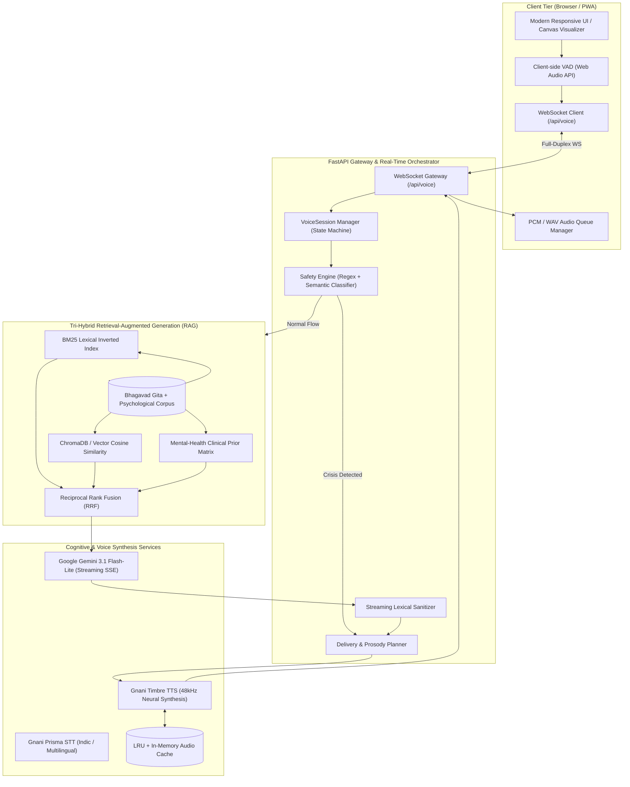
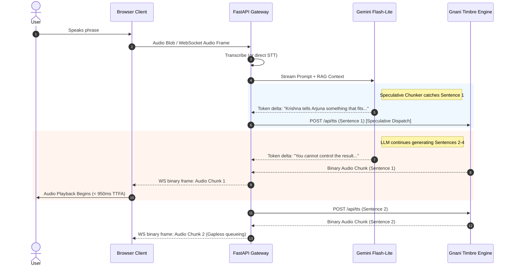
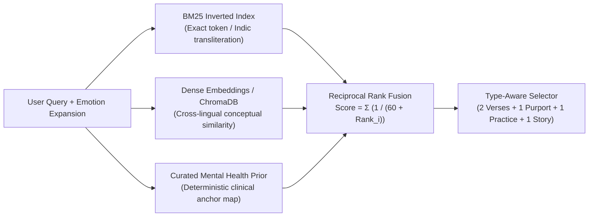
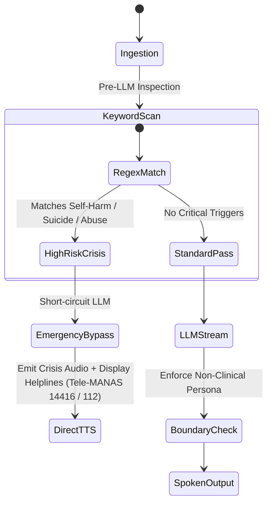
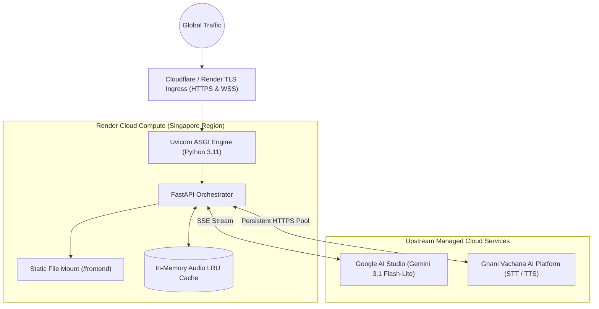

# Project Sahaara: Architecture & Technical Specification

> **System Classification**: Full-Duplex Real-Time Voice Companion & Multilingual RAG System  
> **Core Domain**: Mental Health Support, Emotional Regulation, and Pragmatic Philosophical Wisdom (Bhagavad Gita & Psychological Grounding)  
> **Target Latency Profile**: Time-To-First-Audio (TTFA) < 950ms on mobile networks  

---

## 1. Executive Summary & Problem Space

Modern conversational AI systems face three primary bottlenecks when deployed as empathetic voice companions:
1. **Turn-Taking Latency**: Traditional "Listen $\to$ Transcribe $\to$ Generate $\to$ Speak" cascades impose 3–6 second delays, destroying conversational presence.
2. **Hallucination in Wisdom Retrieval**: Naive generative LLMs frequently confabulate spiritual or philosophical quotes, misattributing verses or generating superficial platitudes.
3. **Acoustic & Psychological Safety**: Automated agents can fail dangerously during acute distress crises or produce robotic, jarring acoustic cadences that aggravate user anxiety.

**Project Sahaara** is engineered from first principles to solve these challenges through a low-latency, resilient architecture that marries:
- A **full-duplex WebSocket streaming audio pipeline** with speculative sentence chunking.
- A **tri-hybrid RAG retrieval engine** (BM25 + Dense Semantic Embeddings + Curated Mental-Health Prior).
- Strict **multi-tier safety guardrails** with instant crisis detection and non-clinical empathetic boundary enforcement.
- Native **multilingual code-switching** designed specifically for Hindi, English, and Hinglish.

---

## 2. High-Level System Architecture

---

## 3. Real-Time Audio Pipeline & Speculative Pipelining

### 3.1 The Time-to-First-Audio (TTFA) Bottleneck
Standard sequential voice loops wait for the LLM to complete its output generation before submitting the text to a Text-to-Speech (TTS) synthesizer:

$$\text{Total Latency} = T_{\text{STT}} + T_{\text{RAG}} + T_{\text{LLM-Complete}} + T_{\text{TTS-Synthesis}} \approx 3.5\text{s} - 6.0\text{s}$$

### 3.2 Sahaara's Speculative Streaming Pipeline
Sahaara decouples the generation and synthesis streams via an asynchronous FIFO queue inside `backend/app/main.py` and `backend/app/textutil.py`:

### 3.3 Text Sanitization & Punctuation Regularization (`StreamCleaner`)
Spoken audio artifacts generated by LLMs (asterisks, bullet points, markdown bolding, parentheses, emojis) severely corrupt neural TTS models. `StreamCleaner` enforces strict sanitization on the fly:
- Removes non-verbal tokens: `*`, `#`, `_`, `~`, `>`
- Transforms markdown quotes into conversational intros (e.g. *"Krishna says:..."*)
- Normalizes punctuation breaks (`...`, `--`) into acoustic pauses (commas and periods) to avoid synthesizer stammering.

---

## 4. The Tri-Hybrid Retrieval Engine (RAG)

Sahaara eliminates hallucinations by feeding the model strict ground-truth verses and psychological practices. The retriever blends three distinct search surfaces:

### 4.1 Scoring Formulation: Reciprocal Rank Fusion (RRF)
Rather than naively normalizing and summing raw cosine similarities and BM25 scores (which have different distributions and scales), Sahaara implements Reciprocal Rank Fusion:

$$\text{RRF Score}(d) = \sum_{m \in M} w_m \cdot \frac{1}{K + \text{rank}_m(d)}$$

Where:
- $K = 60$ (smoothing constant preventing high-rank domination)
- $w_{\text{BM25}} = 1.20$ (lexical exact-match weighting)
- $w_{\text{Dense}} = 1.25$ (semantic embedding match weighting)
- $w_{\text{Prior}} = 0.35$ (domain-curated clinical prior)

### 4.2 The Mental-Health Prior Matrix
Certain life situations (e.g., acute grief, exam panic, paralysis of choice) correspond to quintessential Gita dialogues. `CURATED` maps known emotional clusters directly to canonical passages (e.g., BG 2.14 for emotional resilience, BG 2.47 for detachment from results, BG 6.35 for overcoming overthinking). This guarantees that even if a distressed teenager uses vernacular slang like *"I'm totally cooked"*, the correct therapeutic verses surface with top priority.

---

## 5. Multi-Tier Safety & Crisis Interception

Mental health companion systems require absolute fail-safes. Sahaara operates a deterministic, zero-latency safety filter in `backend/app/safety.py`:

1. **Pre-Cognitive Short-Circuit**: If severe self-harm or suicidal ideation keywords are detected, the LLM call is **aborted immediately**. 
2. **Deterministic Response**: A warm, stabilizing response is injected directly from local memory alongside verified emergency resources:
   - **Tele-MANAS**: `14416` (India National Mental Health Helpline)
   - **Emergency**: `112`
   - **KIRAN**: `1800-599-0019`
3. **Persona Guardrails**: The system prompt explicitly forbids medical diagnosis, pharmacological advice, or toxic positivity (*"just smile"* or *"have faith"*).

---

## 6. Language & Acoustic Architecture

### 6.1 Multilingual Code-Switching Engine
In India and the diaspora, conversational speech is rarely pure Hindi or pure English; it is **Hinglish** with dynamic code-switching.
- **Transliteration Engine**: `backend/app/lang.py` utilizes Unicode-range character classification and ISO-15919 phonetic normalization.
- **Acoustic Phoneme Preservation**: When speaking Sanskrit verses, terms are maintained in phonetically accurate Romanization or Devanagari so Gnani’s neural models pronounce them with correct Vedic cadence rather than Anglicized distortions.

### 6.2 Voice Synthesis & Prosody Matching
- **Prisma STT**: Engineered for Indian accents, ambient room noise, and hybrid English/Hindi vocabulary.
- **Timbre 3.0 TTS**: Configured with a natural speech rate of `0.95x` and 48,000 Hz studio sampling for warmth, avoiding the high-pitched synthetic fatigue common in automated assistants.

---

## 7. Production Deployment & Cloud Topology

The production architecture is completely stateless, lightweight, and container-ready:

### 7.1 Key Infrastructure Characteristics:
- **Zero-Disk Cold Footprint**: Built-in starter wisdom data is embedded directly in Python source structures (`starter.py`), allowing instant boot times (< 3 seconds) on stateless hosts.
- **Persistent HTTP/2 Connection Pools**: Reusable `httpx.AsyncClient` keep-alive pools prevent repeated TLS handshakes when querying upstream LLM and Voice APIs.
- **Auto-Healing Websockets**: The frontend client (`script.js`) monitors connection health, auto-reconnecting on mobile network handoffs with exponential backoff and jitter.

---

## 8. Summary Architecture Metrics

| Metric | Target Specification | Architectural Realization |
| :--- | :--- | :--- |
| **Time-to-First-Audio (TTFA)** | $< 1000\text{ ms}$ | Speculative chunk streaming + parallel TTS dispatch |
| **Retrieval Speed** | $< 15\text{ ms}$ | In-memory BM25 postings + vectorized NumPy matrix |
| **Memory Footprint** | $< 250\text{ MB}$ | Self-contained Python structures without heavy GPU/Torch runtime |
| **Crisis Mitigation Time** | $< 10\text{ ms}$ | Pre-LLM regex short-circuit with deterministic injection |
| **Audio Fidelity** | $48\text{ kHz}$ Studio | High-definition Neural Timbre Voice Model |
